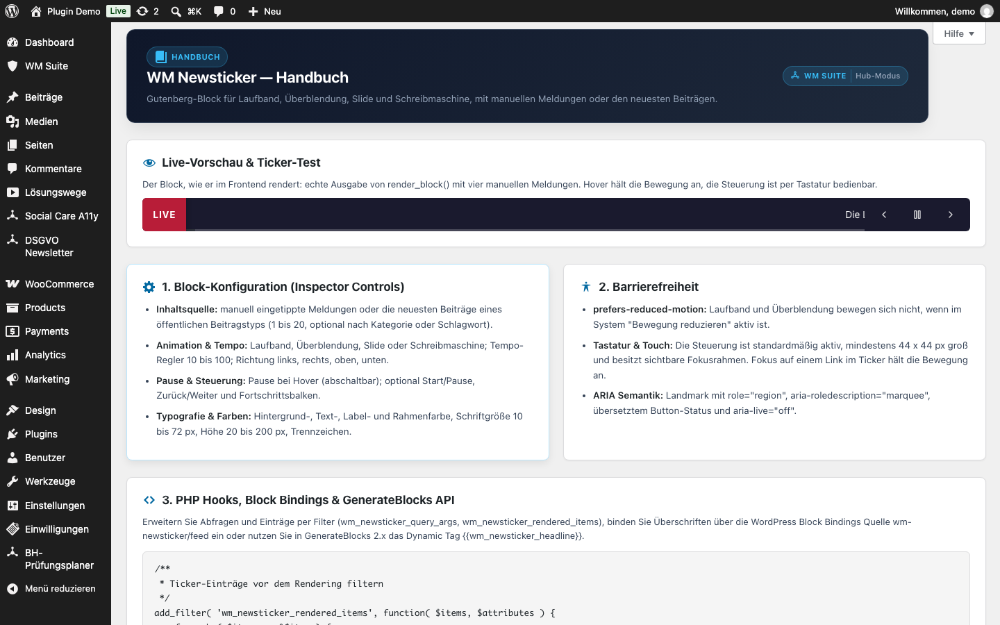
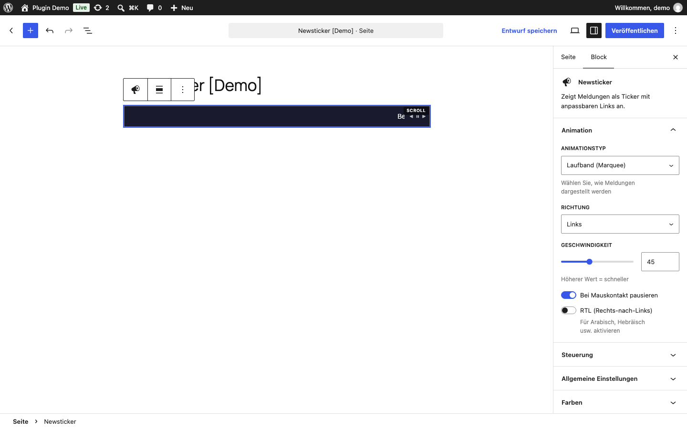
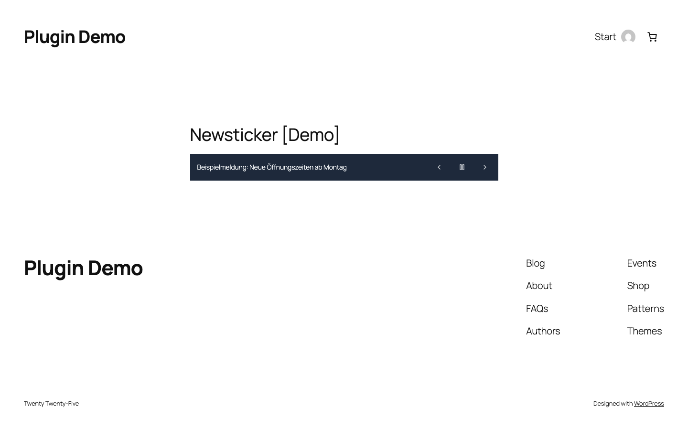
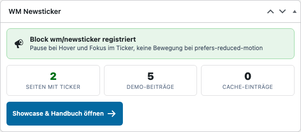

# WM Newsticker (Deutsche Dokumentation)

<p align="center">
  <a href="README.md"></a>
  <a href="README.de.md"></a>
  <a href="README.es.md"></a>
</p>

> **Gutenberg-Block für animierte Newsticker: Scroll, Fade, Slide und Typing, mit manuellen Schlagzeilen oder den neuesten Beiträgen**  
> **Plugin-Seite:** [https://arnoldwender.com/wordpress-plugins/wm-newsticker/](https://arnoldwender.com/wordpress-plugins/wm-newsticker/) · **Repository:** [github.com/arnoldwender/wm-wp-newsticker](https://github.com/arnoldwender/wm-wp-newsticker)  
> **Mit einem agentischen Workflow entwickelt:** entstanden mit KI-Coding-Agenten. Prüfen und testen Sie es wie jeden fremden Code, bevor Sie es produktiv einsetzen.  
> **Support & Haftung:** Kein Support (Zero Support) — reproduzierbare Bugs ausschließlich über [GitHub Issues](https://github.com/arnoldwender/wm-wp-newsticker/issues) · kein privater Support · OHNE GEWÄHR („AS IS“) / keine Haftung ([SUPPORT.md](SUPPORT.md))

> Gemessen am Code am 2026-11-21 (Version 1.6.1). Jedes beschriebene Verhalten, jede Dateigröße, jedes Kontrastverhältnis und jede Übersetzungszahl stammt direkt aus den Quelldateien und Test-Gates.

---

## Screenshots

!WM Newsticker Banner

| Handbuch & Live-Vorschau | Gutenberg-Editor | Frontend-Tickerleiste | Dashboard-Widget |
|---|---|---|---|
|  |  |  |  |

---

## Was das Plugin leistet

1. **Ein dynamischer Block, `wm/newsticker`.** `block.json` (API-Version 3) mit Editor-Skript (`build/index.js`, 18,8 KB / 5,0 KB gzip), Editor-Styles (`build/index.css`, 3,4 KB / 1,1 KB gzip), Frontend-Styles (`build/style-index.css`, 7,2 KB / 1,5 KB gzip) und View-Skript (`build/frontend.js`, 3,5 KB / 1,1 KB gzip), die WordPress nur auf Seiten mit dem Block lädt. Das Markup erzeugt `WM_Newsticker::render_block()`.
2. **Vier Animationen.** Scroll (eine CSS-`translateX`-Keyframe-Schleife; ab mehr als zwei Einträgen gibt der Server die Liste doppelt aus, damit die Schleife nahtlos läuft), Fade, Slide und Typing. Richtung links, rechts, hoch oder runter, Umschalter für Rechts-nach-Links sowie ein Geschwindigkeitsregler von 10 bis 100 für die Animationsdauer.
3. **Zwei Inhaltsquellen.** Manuelle Schlagzeilen (Text, Link, im neuen Tab öffnen) oder die neuesten veröffentlichten Beiträge eines öffentlichen, über die REST-API verfügbaren Beitragstyps: 1 bis 20 Beiträge, optionale Kategorie- und Schlagwort-Filter, sortiert nach Datum, Titel, Änderungsdatum, Zufall oder Kommentaranzahl, optional mit relativem oder absolutem Datum. Beitragsabfragen werden 5 Minuten lang in einem Transient gecacht; `save_post` und `deleted_post` leeren den Cache.
4. **Design-Attribute.** Hintergrund-, Text-, Label-Hintergrund- (Standard `#b81d38`, Kontrast 6,42:1 zu `#ffffff`), Label-Text- und Rahmenfarben (3-, 4-, 6- oder 8-stelliges Hex, `rgb()` / `rgba()`, `var(--…)`, `transparent`, `inherit`, `currentcolor`; alles andere fällt auf `#000000` zurück), Innen- und Außenabstände, Eckenradius, Rahmenbreite und -stil, vier Schatten-Presets, Schriftgröße 10 bis 72 px, Höhe 20 bis 200 px (Standard 48 px), optionales Label und Trennzeichen mit bis zu fünf Zeichen.
5. **Bedienelemente standardmäßig aktiv.** Schaltflächen für Zurück / Weiter und Wiedergabe / Pause (`min-width: 44px; min-height: 44px` auf Desktop und Mobilgeräten, übersetzte ARIA-Zustände `data-label-pause` / `data-label-play`) sowie eine optionale Fortschrittsleiste, links oder rechts platziert. Die Bewegung pausiert bei Mauszeiger-Hover (standardmäßig an) sowie sobald ein Element innerhalb von `.wm-newsticker-content` Tastaturfokus erhält (`focusin` / `focusout` in JS und `:focus-within` in CSS).
6. **Barrierefreiheit im Markup.** Der Container trägt `role="region"`, `aria-roledescription="marquee"`, ein übersetztes `aria-label` und `aria-live="off"`; Bedienelemente sind `<button type="button">`-Elemente mit `:focus-visible`-Umriss; bei `prefers-reduced-motion: reduce` laufen Scroll-Animation und Slide-Rotation nicht.
7. **Block Bindings, GenerateBlocks 2.x, Patterns & Abilities (`includes/class-newsticker-integrations.php`).**
   - WordPress-6.5+-Block-Bindings-Quelle `wm-newsticker/feed` (Felder `headline` und `url`, `post_type`, `offset`).
   - GenerateBlocks-2.x-Dynamic-Tag `{{wm_newsticker_headline}}`, registriert über `GenerateBlocks_Register_Dynamic_Tag`, sobald GenerateBlocks 2.0+ aktiv ist.
   - Block-Vorlagen `wm-newsticker/breaking-news-bar` sowie (bei aktivem GenerateBlocks) zweischichtiges `wm-newsticker/gb-breaking-section` (`gbp-section` + `gbp-section__inner` mit globalen GeneratePress-Farbvariablen).
   - Deklarative WordPress-6.9+-Ability `wm-newsticker/get-headlines` mit bereinigten, gecachten öffentlichen Schlagzeilen.
8. **Hooks für Drittanbieter-Plugins.** `wm_newsticker_query_args( $args, $attributes )` (wobei `post_status = 'publish'` danach erzwungen wird), `wm_newsticker_rendered_items( $items, $attributes )` (vor dem Escaping angewendet) und `wm_newsticker_after_render( $unique_id, $items, $attributes )`.
9. **Administration.** Eine Handbuch-Seite (Hauptmenü *WM Newsticker*, Untermenüs und ein Eintrag unter *Einstellungen*) mit Live-Vorschau aus der echten `render_block()`-Ausgabe, kontextuellen Hilfetabs, Schaltflächen zum Erzeugen oder Löschen von Demodaten (vier Beispielbeiträge und eine Beispielseite mit `_is_wm_newsticker_demo`), einer Opt-in-Checkbox (`wm_newsticker_delete_demo_on_uninstall`, standardmäßig aus) für `uninstall.php` sowie einem Dashboard-Widget mit gezählten Werten (Seiten mit Block, Demo-Beiträge, gecachte Abfragen) auf den Admin-Stylesheets der WM-Suite-Familie.
10. **WP-CLI:** `wp newsticker post-types`, `wp newsticker flush-cache`, `wp newsticker demodaten --import | --delete | --reset [--yes]`.
11. **REST-Route** `GET /wp-json/wm-newsticker/v1/post-types` für den Editor (`permission_callback`: `current_user_can( 'edit_posts' )`); listet öffentliche Beitragstypen mit REST-Unterstützung ohne Anhänge.
12. **WM Suite Hub Spoke** (`includes/class-newsticker-spoke-adapter.php`): CycloneDX-SBOM-Eintrag mit SHA-256 der Hauptdatei, Telemetrie und Aktionen über `wm_register_suite_module`.
13. **Übersetzungen & WPML:** 28 `.po`- / `.mo`-Kataloge und 28 Gutenberg-JED-`.json`-Kataloge in `languages/` (`4.839 / 5.320` nicht-identische Einträge über alle 28 Sprachpakete; `tests/test-pot-freshness.php` prüft 0 fehlende Strings); `wpml-config.xml` markiert Label, Trennzeichen und Schlagzeilentexte als übersetzbar.

### Nicht enthalten

Kein Shortcode, kein klassisches Widget, keine Verarbeitung personenbezogener Besucherdaten, keine Cookies oder Browserspeicher, keine externen Anfragen.

---

## Schnellstart

1. Plugin installieren und aktivieren (WordPress 5.9+, PHP 7.4+ laut Header; CI prüft PHP 7.4 sowie 8.1 bis 8.3).
2. Im Block-Editor **Newsticker** (`/newsticker`) einfügen oder eine der **WM Newsticker**-Block-Vorlagen wählen.
3. Inhaltsquelle, Animation und Farben in der Block-Seitenleiste wählen oder einen Core-Absatz-, Überschrift- oder GenerateBlocks-Textblock an `wm-newsticker/feed` / `{{wm_newsticker_headline}}` binden.
4. Das Handbuch unter **WM Newsticker** zeigt eine Live-Vorschau, verwaltet Demodaten und erlaubt das Aktivieren der Demo-Bereinigung bei Deinstallation.

---

## Entwickler

Architektur: [docs/ARCHITECTURE.md](docs/ARCHITECTURE.md) · Klassen, Attribute und Hooks: [docs/DEVELOPER-GUIDE.md](docs/DEVELOPER-GUIDE.md) · Barrierefreiheit: [docs/ACCESSIBILITY.md](docs/ACCESSIBILITY.md) · Datenschutz: [docs/DSGVO-COMPLIANCE.md](docs/DSGVO-COMPLIANCE.md) · Sicherheitshinweise: [docs/SECURITY-AUDIT.md](docs/SECURITY-AUDIT.md)

```bash
npm install
npm run build        # wp-scripts build; postbuild bin/harden-build-assets.mjs ergänzt ABSPATH-Schutz in build/*.asset.php
npm run start        # Watch-Modus

php tests/test-suite.php          # Standalone-Suite ohne WordPress
bash tests/run-mutations.sh       # jede rückgängig gemachte Korrektur in tests/mutations.php muss rot werden
php tests/test-pot-freshness.php  # jeder übersetzte String hat einen .pot-Eintrag (benötigt wp-cli)
python3 .github/scripts/security-audit.py
```

`build/` wird versioniert ausgeliefert, sodass das Plugin ohne Build-Schritt läuft; `/src/`, `package.json` und `bin/` liegen im WordPress.org-Paket für reproduzierbare Builds bei.

### Hinweise & Grenzen

- Gleichzeitige Anfragen bei abgelaufenem 5-Minuten-Transient führen jeweils `WP_Query` aus (kein verteilter Stampede-Lock).
- Vor dem 2026-09-15 angelegte Demobeiträge tragen ältere Beispielschlagzeilen (siehe CHANGELOG); über „Demodaten bereinigen“ entfernen und bei Bedarf neu anlegen.
- Es wurde kein formales externes Barrierefreiheits-Audit gegen WCAG oder BFSG durchgeführt; ob eine Seite gesetzliche Anforderungen erfüllt, hängt vom aktiven Theme, dem Seitenaufbau und den gewählten Farben ab.

---

## Datenschutz und Barrierefreiheit

- **Keine externen Anfragen:** Skripte, Styles und Icons stammen lokal aus dem Plugin; keine externen Schriftarten, CDNs oder Tracking.
- **Keine personenbezogenen Daten:** Der Block gibt Beitragstitel und Schlagzeilen aus; er setzt keine Cookies und schreibt nichts in den Browserspeicher.
- **Barrierefreiheit:** Technische Maßnahmen und verbleibende Grenzen stehen in [docs/ACCESSIBILITY.md](docs/ACCESSIBILITY.md). Eine rechtliche Konformität wird nicht behauptet.

---

## Lizenz

GPL v2 oder neuer — siehe LICENSE oder die [GNU General Public License v2.0](https://www.gnu.org/licenses/gpl-2.0.html).
