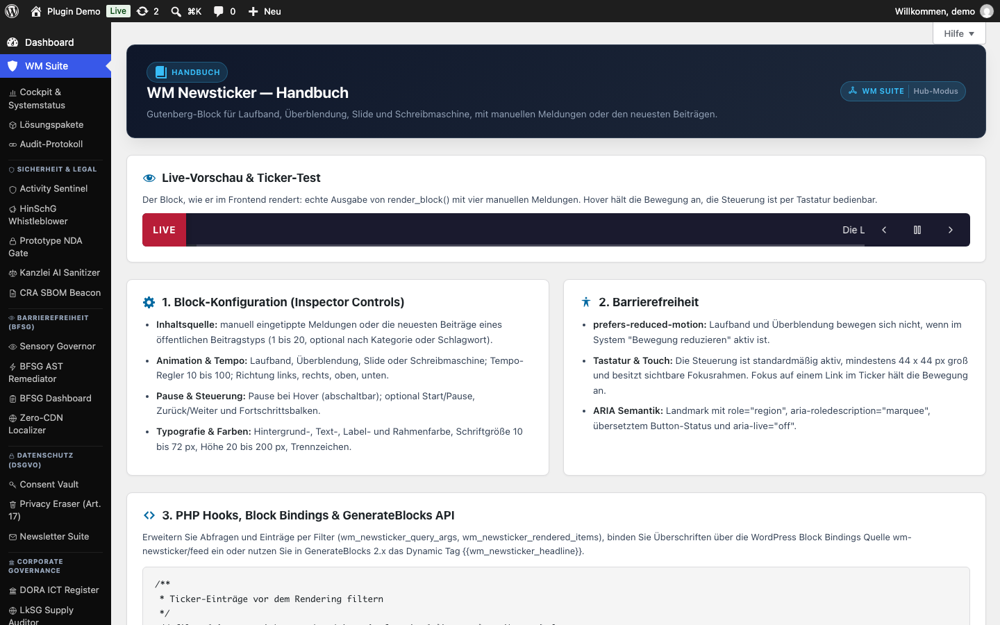
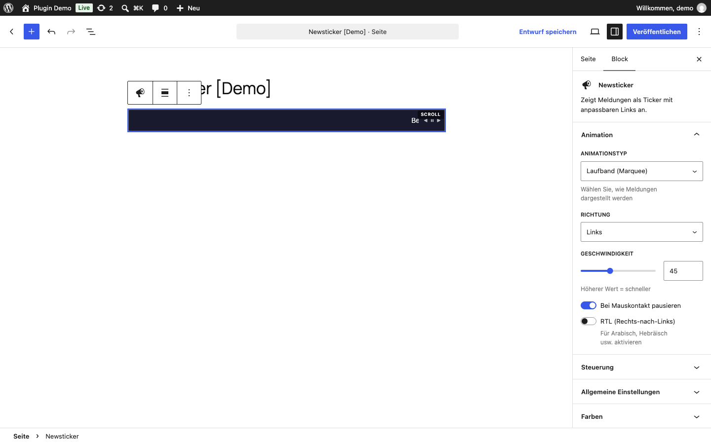
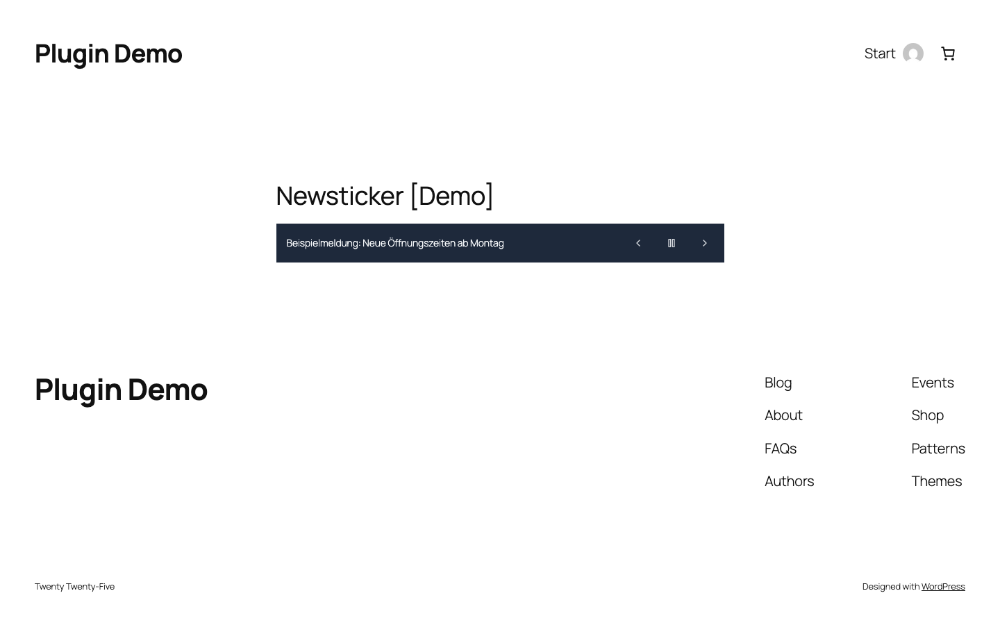
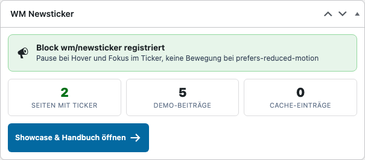

# WM Newsticker (Documentación en Español)

<p align="center">
  <a href="README.md"></a>
  <a href="README.de.md"></a>
  <a href="README.es.md"></a>
</p>

> **Bloque de Gutenberg para teletipos de noticias animados: desplazamiento (scroll), fundido (fade), deslizamiento (slide) y escritura (typing), con titulares manuales o las últimas entradas**  
> **Página del Plugin:** [https://arnoldwender.com/es/plugins-wordpress/wm-newsticker/](https://arnoldwender.com/es/plugins-wordpress/wm-newsticker/) · **Repositorio:** [github.com/arnoldwender/wm-wp-newsticker](https://github.com/arnoldwender/wm-wp-newsticker)  
> **Desarrollado con un agentic workflow:** creado con agentes de programación de IA. Revísalo y pruébalo como cualquier código de terceros antes de usarlo en producción.  
> **Soporte y responsabilidad:** Cero soporte (Zero Support) — errores reproducibles únicamente en [GitHub Issues](https://github.com/arnoldwender/wm-wp-newsticker/issues) · sin soporte privado · TAL CUAL («AS IS») / sin responsabilidad ([SUPPORT.md](SUPPORT.md))

> Medido sobre el código el 2026-11-21 (versión 1.6.2). Cada comportamiento, tamaño de recurso, relación de contraste y conteo de traducciones procede directamente de los archivos fuente y las pruebas automáticas.

---

## Capturas en vivo

!Banner de WM Newsticker

| Manual y vista previa en vivo | Editor Gutenberg | Barra en el frontend | Widget del escritorio |
|---|---|---|---|
|  |  |  |  |

---

## Qué hace el plugin

1. **Un bloque dinámico, `wm/newsticker`.** `block.json` (API versión 3) con script de editor (`build/index.js`, 18,8 KB / 5,0 KB gzip), estilos de editor (`build/index.css`, 3,4 KB / 1,1 KB gzip), estilos de frontend (`build/style-index.css`, 7,2 KB / 1,5 KB gzip) y script de vista (`build/frontend.js`, 3,5 KB / 1,1 KB gzip) que WordPress carga únicamente en páginas que contienen el bloque. El HTML lo genera `WM_Newsticker::render_block()`.
2. **Cuatro animaciones.** Scroll (bucle CSS con keyframes `translateX`; con más de dos elementos el servidor renderiza la lista dos veces para un bucle continuo), fade, slide y typing. Dirección izquierda, derecha, arriba o abajo, conmutador de derecha a izquierda (RTL) y control deslizante de velocidad de 10 a 100 para la duración de la animación.
3. **Dos fuentes de contenido.** Titulares manuales (texto, enlace, abrir en nueva pestaña) o las últimas entradas publicadas de un tipo de contenido público disponible en la API REST: de 1 a 20 entradas, filtros opcionales por categoría y etiqueta, ordenadas por fecha, título, fecha de modificación, aleatorio o número de comentarios, con prefijo opcional de fecha relativa o absoluta. Las consultas se guardan en caché transient durante 5 minutos; `save_post` y `deleted_post` vacían la caché.
4. **Atributos de diseño.** Colores de fondo, texto, fondo de etiqueta (por defecto `#b81d38`, contraste 6,42:1 con `#ffffff`), texto de etiqueta y borde (hexadecimal de 3, 4, 6 u 8 dígitos, `rgb()` / `rgba()`, `var(--…)`, `transparent`, `inherit`, `currentcolor`; cualquier otro valor cae en `#000000`), padding, margen, radio de borde, grosor y estilo de borde, cuatro presets de sombra, tamaño de fuente de 10 a 72 px, altura de 20 a 200 px (48 px por defecto), etiqueta opcional y separador de hasta cinco caracteres.
5. **Controles habilitados por defecto.** Botones de anterior / siguiente y reproducción / pausa (`min-width: 44px; min-height: 44px` en escritorio y móvil, estados ARIA traducidos `data-label-pause` / `data-label-play`) más una barra de progreso opcional, situada a la izquierda o a la derecha. La animación se pausa al pasar el cursor (activado por defecto) y cuando cualquier elemento dentro de `.wm-newsticker-content` recibe el foco de teclado (`focusin` / `focusout` en JS y `:focus-within` en CSS).
6. **Accesibilidad en el marcado.** El contenedor incluye `role="region"`, `aria-roledescription="marquee"`, un `aria-label` traducido y `aria-live="off"`; los controles son elementos `<button type="button">` con contorno `:focus-visible`; con `prefers-reduced-motion: reduce` no se ejecutan la animación scroll ni la rotación slide.
7. **Block Bindings, GenerateBlocks 2.x, Patrones y Abilities (`includes/class-newsticker-integrations.php`).**
   - Fuente de Block Bindings de WordPress 6.5+ `wm-newsticker/feed` (campos `headline` y `url`, `post_type`, `offset`).
   - Etiqueta dinámica de GenerateBlocks 2.x `{{wm_newsticker_headline}}` registrada con `GenerateBlocks_Register_Dynamic_Tag` cuando GenerateBlocks 2.0+ está activo.
   - Patrones de bloque `wm-newsticker/breaking-news-bar` y (con GenerateBlocks activo) la sección de dos capas `wm-newsticker/gb-breaking-section` (`gbp-section` + `gbp-section__inner` con variables globales de color de GeneratePress).
   - Ability declarativa de WordPress 6.9+ `wm-newsticker/get-headlines` que devuelve titulares públicos saneados y cacheados.
8. **Hooks para plugins de terceros.** `wm_newsticker_query_args( $args, $attributes )` (forzando `post_status = 'publish'` después), `wm_newsticker_rendered_items( $items, $attributes )` (aplicado antes de escapar) y `wm_newsticker_after_render( $unique_id, $items, $attributes )`.
9. **Administración.** Pantalla de manual (menú principal *WM Newsticker*, submenús y entrada bajo *Ajustes*) con vista previa en vivo generada por el `render_block()` real, pestañas de ayuda contextual, botones para crear o borrar datos de demostración (cuatro entradas de ejemplo y una página de ejemplo marcadas con `_is_wm_newsticker_demo`), casilla opt-in (`wm_newsticker_delete_demo_on_uninstall`, desactivada por defecto) para controlar la limpieza en `uninstall.php`, y widget del escritorio con cifras contadas (páginas con el bloque, entradas demo, consultas cacheadas) sobre las hojas de la familia de administración de WM Suite.
10. **WP-CLI:** `wp newsticker post-types`, `wp newsticker flush-cache`, `wp newsticker demodaten --import | --delete | --reset [--yes]`.
11. **Ruta REST** `GET /wp-json/wm-newsticker/v1/post-types` para el editor (`permission_callback`: `current_user_can( 'edit_posts' )`); lista tipos de entrada públicos con soporte REST, excluyendo adjuntos.
12. **Spoke de WM Suite Hub** (`includes/class-newsticker-spoke-adapter.php`): entrada SBOM CycloneDX con el SHA-256 del archivo principal, telemetría y acciones registradas mediante `wm_register_suite_module`.
13. **Traducciones y WPML:** 28 catálogos `.po` / `.mo` y 28 catálogos JED `.json` del editor Gutenberg en `languages/` (`4.839 / 5.320` entradas traducidas distintas entre los 28 locales; `tests/test-pot-freshness.php` verifica 0 cadenas faltantes); `wpml-config.xml` marca etiqueta, separador y textos de titulares como traducibles.

### No incluido

Ningún shortcode, ningún widget clásico, ningún tratamiento de datos personales de visitantes, ninguna cookie ni almacenamiento en el navegador, ninguna petición externa.

---

## Inicio rápido

1. Instala y activa el plugin (WordPress 5.9+, PHP 7.4+ según la cabecera; CI prueba PHP 7.4 y 8.1 a 8.3).
2. En el editor de bloques inserta **Newsticker** (`/newsticker`) o elige uno de los patrones **WM Newsticker**.
3. Elige fuente de contenido, animación y colores en la barra lateral del bloque, o vincula un bloque Core de párrafo / encabezado / texto de GenerateBlocks a `wm-newsticker/feed` / `{{wm_newsticker_headline}}`.
4. El manual en **WM Newsticker** muestra una vista previa en vivo, gestiona contenido demo y permite elegir si los datos demo deben eliminarse al desinstalar.

---

## Desarrolladores

Arquitectura: [docs/ARCHITECTURE.md](docs/ARCHITECTURE.md) · Clases, atributos y hooks: [docs/DEVELOPER-GUIDE.md](docs/DEVELOPER-GUIDE.md) · Accesibilidad: [docs/ACCESSIBILITY.md](docs/ACCESSIBILITY.md) · Privacidad: [docs/DSGVO-COMPLIANCE.md](docs/DSGVO-COMPLIANCE.md) · Notas de seguridad: [docs/SECURITY-AUDIT.md](docs/SECURITY-AUDIT.md)

```bash
npm install
npm run build        # wp-scripts build; postbuild bin/harden-build-assets.mjs repone la guarda ABSPATH en build/*.asset.php
npm run start        # modo watch

php tests/test-suite.php          # suite standalone, sin WordPress
bash tests/run-mutations.sh       # cada corrección de tests/mutations.php deshecha debe poner la suite en rojo
php tests/test-pot-freshness.php  # cada cadena traducida tiene entrada en el .pot (requiere wp-cli)
python3 .github/scripts/security-audit.py
```

`build/` se versiona para que el plugin funcione sin paso de compilación, y `/src/`, `package.json` y `bin/` se incluyen en el paquete de distribución de WordPress.org para que el build sea reproducible desde el ZIP.

### Notas y limitaciones

- Las peticiones concurrentes cuando expira un transient de 5 minutos ejecutan `WP_Query` cada una (no hay bloqueo distribuido contra stampede).
- Las entradas demo creadas antes del 2026-09-15 llevan titulares de ejemplo antiguos (ver CHANGELOG); elimínalas con «Demodaten bereinigen» y vuelve a generarlas si hace falta.
- No se ha realizado ninguna auditoría formal externa contra WCAG ni BFSG; el cumplimiento legal de una página depende del tema activo, la estructura de la página y los colores elegidos por el autor.

---

## Privacidad y accesibilidad

- **Sin peticiones externas:** scripts, estilos e iconos se sirven desde el plugin; sin fuentes externas, CDNs ni rastreo.
- **Sin datos personales:** el bloque renderiza títulos de entradas y titulares; no fija cookies ni escribe en almacenamiento del navegador.
- **Accesibilidad:** las medidas técnicas y limitaciones vigentes se documentan en [docs/ACCESSIBILITY.md](docs/ACCESSIBILITY.md). No se afirma conformidad legal.

---

## Licencia

GPL v2 o posterior — ver LICENSE o la [GNU General Public License v2.0](https://www.gnu.org/licenses/gpl-2.0.html).
