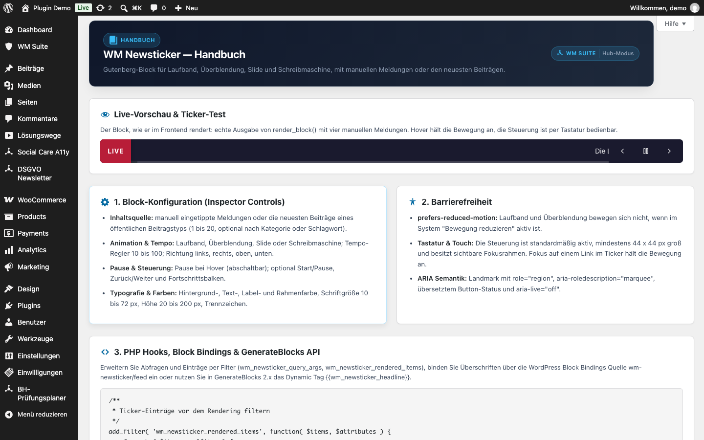
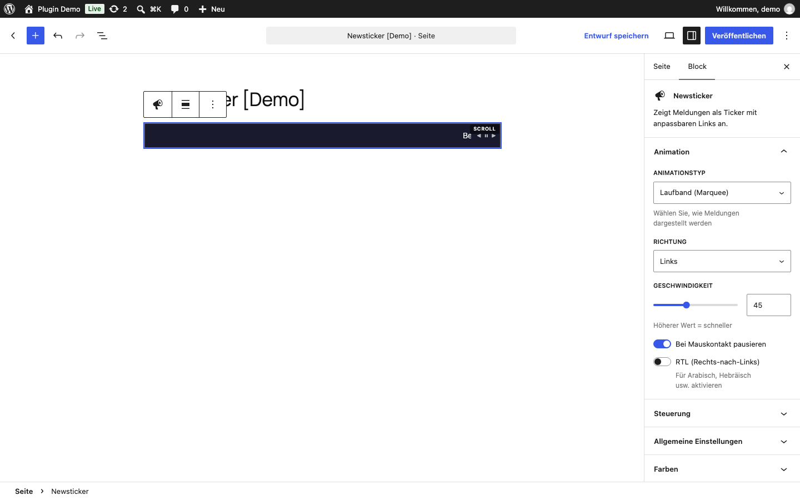
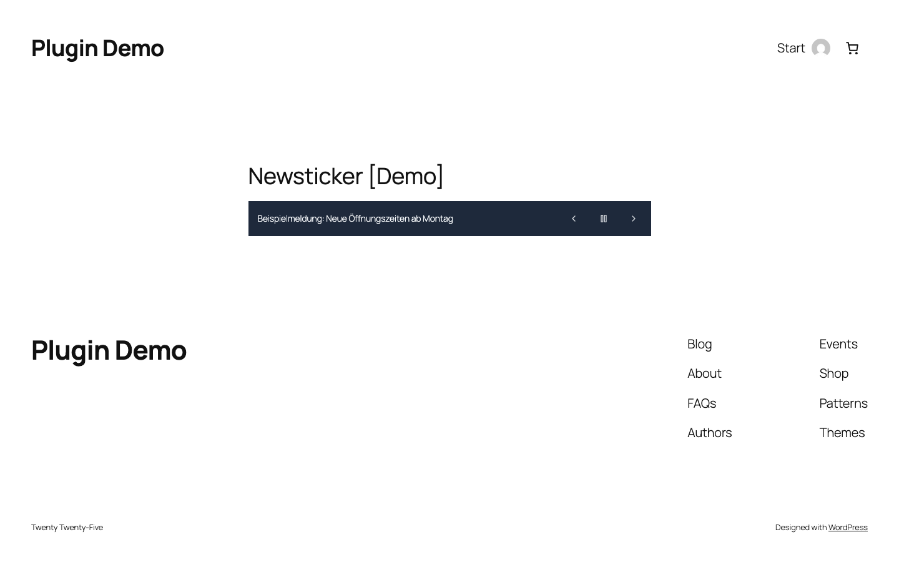
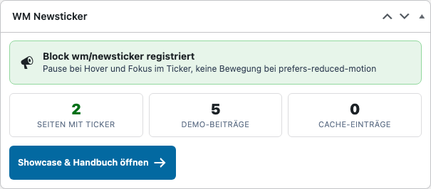

# WM Newsticker

<p align="center">
  <a href="README.md"></a>
  <a href="README.de.md"></a>
  <a href="README.es.md"></a>
</p>

> **Gutenberg block for animated news tickers: scroll, fade, slide and typing, with manual headlines or the latest posts**  
> **Plugin Page:** [https://arnoldwender.com/wordpress-plugins/wm-newsticker/](https://arnoldwender.com/wordpress-plugins/wm-newsticker/) · **Repository:** [github.com/arnoldwender/wm-wp-newsticker](https://github.com/arnoldwender/wm-wp-newsticker)  
> **Built with an agentic workflow:** developed with AI coding agents. Review and test it like any third-party code before you use it in production.  
> **Support & Liability:** Zero support — reproducible bugs on [GitHub Issues](https://github.com/arnoldwender/wm-wp-newsticker/issues) only · no private support · AS IS / no liability ([SUPPORT.md](SUPPORT.md))

> Measured against the code on 2026-11-21 (version 1.6.2). Every behaviour, asset size, contrast ratio and translation count below comes directly from the source files and test gates.

---

## Screenshots

!WM Newsticker banner

| Handbook & Live Preview | Gutenberg Editor | Frontend Bar | Dashboard Widget |
|---|---|---|---|
|  |  |  |  |

---

## What the plugin does

1. **One dynamic block, `wm/newsticker`.** `block.json` (API version 3) with an editor script (`build/index.js`, 18.8 KB / 5.0 KB gzip), editor styles (`build/index.css`, 3.4 KB / 1.1 KB gzip), frontend styles (`build/style-index.css`, 7.2 KB / 1.5 KB gzip) and a view script (`build/frontend.js`, 3.5 KB / 1.1 KB gzip) that WordPress loads only on pages carrying the block. The markup comes from `WM_Newsticker::render_block()`.
2. **Four animations.** Scroll (a CSS `translateX` keyframe loop; with more than two items the server renders the list twice so the loop is seamless), fade, slide and typing. Direction left, right, up or down, a right-to-left toggle, and a speed slider from 10 to 100 that sets the animation duration.
3. **Two content sources.** Manual headlines (text, link, open in new tab) or the latest published posts of a public post type that is available in the REST API: 1 to 20 posts, optional category and tag filters, ordered by date, title, modified date, random or comment count, optionally prefixed with a relative or absolute date. Post queries are cached for 5 minutes in a transient; `save_post` and `deleted_post` clear the cache.
4. **Design attributes.** Background, text, label background (default `#b81d38`, 6.42:1 contrast with `#ffffff`), label text and border colours (hex with 3, 4, 6 or 8 digits, `rgb()` / `rgba()`, `var(--…)`, `transparent`, `inherit`, `currentcolor`; anything else becomes `#000000`), padding, margin, border radius, border width and style, four shadow presets, font size 10 to 72 px, height 20 to 200 px (default 48 px), an optional label and a separator of up to five characters.
5. **Controls enabled by default.** Previous / next and play / pause buttons (`min-width: 44px; min-height: 44px` on desktop and mobile, translated `data-label-pause` / `data-label-play` ARIA states) plus an optional progress bar, placed left or right. Motion pauses on pointer hover (on by default) and whenever an element inside `.wm-newsticker-content` receives keyboard focus (`focusin` / `focusout` in JS and `:focus-within` in CSS).
6. **Accessibility in the markup.** The wrapper carries `role="region"`, `aria-roledescription="marquee"`, a translated `aria-label` and `aria-live="off"`; controls are `<button type="button">` elements with `:focus-visible` outlines; with `prefers-reduced-motion: reduce` the scroll animation and slide rotation do not run.
7. **Block Bindings, GenerateBlocks 2.x, Patterns & Abilities (`includes/class-newsticker-integrations.php`).**
   - WordPress 6.5+ Block Bindings source `wm-newsticker/feed` (`headline` and `url` fields, `post_type`, `offset`).
   - GenerateBlocks 2.x Dynamic Tag `{{wm_newsticker_headline}}` registered via `GenerateBlocks_Register_Dynamic_Tag` when GenerateBlocks 2.0+ is active.
   - Block Patterns `wm-newsticker/breaking-news-bar` and (when GenerateBlocks is active) two-layer `wm-newsticker/gb-breaking-section` (`gbp-section` + `gbp-section__inner` with GeneratePress global colour variables).
   - Declarative WordPress 6.9+ Ability `wm-newsticker/get-headlines` returning sanitized, cached public headlines.
8. **Hooks for third-party plugins.** `wm_newsticker_query_args( $args, $attributes )` (with `post_status = 'publish'` enforced afterwards), `wm_newsticker_rendered_items( $items, $attributes )` (applied before escaping), and `wm_newsticker_after_render( $unique_id, $items, $attributes )`.
9. **Admin.** A handbook screen (top-level menu *WM Newsticker*, its submenus and an entry under *Settings*) with a live preview that is the block's real `render_block()` output, contextual help tabs, buttons that create or delete demo content (four example posts and an example page, marked with `_is_wm_newsticker_demo`), an opt-in checkbox (`wm_newsticker_delete_demo_on_uninstall`, default off) controlling whether `uninstall.php` deletes demo items on plugin removal, and a dashboard widget with counted figures (pages carrying the block, demo posts, cached queries). All on the WM Suite admin family sheets.
10. **WP-CLI:** `wp newsticker post-types`, `wp newsticker flush-cache`, `wp newsticker demodaten --import | --delete | --reset [--yes]`.
11. **REST route** `GET /wp-json/wm-newsticker/v1/post-types` for the editor, `permission_callback` `current_user_can( 'edit_posts' )`; it lists public post types with REST support, without attachments.
12. **WM Suite Hub spoke** (`includes/class-newsticker-spoke-adapter.php`): CycloneDX SBOM entry with the SHA-256 of the main file, telemetry and actions, registered through `wm_register_suite_module`.
13. **Translations & WPML:** 28 `.po` / `.mo` catalogs and 28 Gutenberg editor JED `.json` catalogs in `languages/` (`4,839 / 5,320` non-identical entries across all 28 locales; `tests/test-pot-freshness.php` verifies 0 missing strings); `wpml-config.xml` marks label, separator and headline texts as translatable.

### Not shipped

No shortcode, no classic widget, no processing of visitors' personal data, no cookies or browser storage, no external requests.

---

## Quick start

1. Install and activate the plugin (WordPress 5.9+, PHP 7.4+ per the header; CI tests PHP 7.4 and 8.1 to 8.3).
2. In the block editor insert **Newsticker** (`/newsticker`) or choose one of the **WM Newsticker** block patterns.
3. Choose the content source, animation and colours in the block sidebar, or bind a Core Paragraph / Heading / GenerateBlocks Text block to `wm-newsticker/feed` / `{{wm_newsticker_headline}}`.
4. The handbook under **WM Newsticker** shows a live preview, manages demo content, and lets you choose whether demo content should be deleted upon uninstall.

---

## Developers

Architecture: [docs/ARCHITECTURE.md](docs/ARCHITECTURE.md) · Classes, attributes and hooks: [docs/DEVELOPER-GUIDE.md](docs/DEVELOPER-GUIDE.md) · Accessibility: [docs/ACCESSIBILITY.md](docs/ACCESSIBILITY.md) · Privacy: [docs/DSGVO-COMPLIANCE.md](docs/DSGVO-COMPLIANCE.md) · Security notes: [docs/SECURITY-AUDIT.md](docs/SECURITY-AUDIT.md)

```bash
npm install
npm run build        # wp-scripts build; postbuild bin/harden-build-assets.mjs re-adds the ABSPATH guard to build/*.asset.php
npm run start        # watch mode

php tests/test-suite.php          # standalone suite, no WordPress needed
bash tests/run-mutations.sh       # each correction in tests/mutations.php undone must turn the suite red
php tests/test-pot-freshness.php  # every string the code translates has an entry in the .pot (needs wp-cli)
python3 .github/scripts/security-audit.py

# inside WordPress
wp eval-file wp-content/plugins/wm-newsticker/tests/test-newsticker-core.php
wp eval-file wp-content/plugins/wm-newsticker/tests/test-i18n.php
```

`build/` is versioned so the plugin installs without a build step, and `/src/`, `package.json`, and `bin/` are included in the WordPress.org distribution package so the build is reproducible from the distributed ZIP.

### Notes & limitations

- Concurrent requests that miss an expired 5-minute transient each run `WP_Query` (there is no distributed stampede lock).
- Demo posts seeded before 2026-09-15 carry older sample headlines (see CHANGELOG); remove them with "Demodaten bereinigen" and seed again if needed.
- No formal third-party accessibility audit against WCAG or the BFSG has been performed; whether a page meets statutory requirements depends on the active theme, page structure, and author-chosen colours.

---

## Privacy and accessibility

- **No external requests:** scripts, styles and icons are served from the plugin; no fonts, CDNs or tracking.
- **No personal data:** the block renders post titles and headlines; it sets no cookies and writes no browser storage.
- **Accessibility:** technical measures and remaining boundaries are documented in [docs/ACCESSIBILITY.md](docs/ACCESSIBILITY.md). No legal conformity is claimed.

---

## License

GPL v2 or later — see LICENSE or the [GNU General Public License v2.0](https://www.gnu.org/licenses/gpl-2.0.html).
